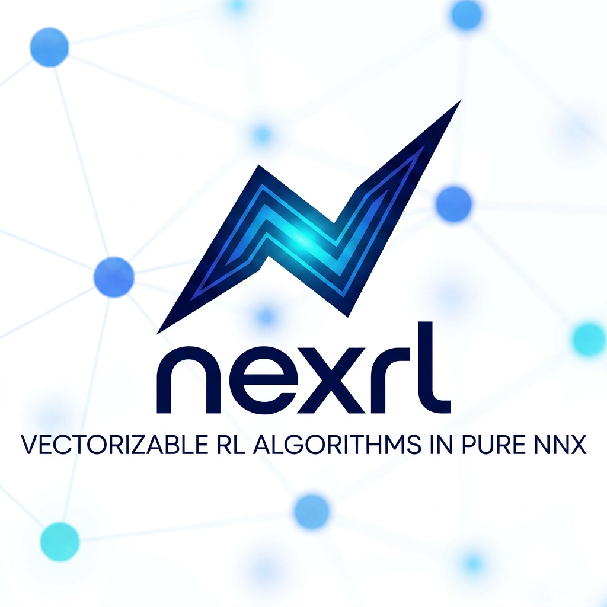

<div style="display: flex; align-items: center">
<div style="flex-shrink: 0.5; min-width: 30px; max-width: 150px; aspect-ratio: 1; margin-right: 15px">
  </img>
</div>
<div>
  <h1>
    nexrl
    <br>
    <span style="font-size: large">Vectorizable RL algorithms in pure JAX</span>
    <br>
    <a href="https://opensource.org/licenses/Apache-2.0">
      
    </a>
  </h1>
  </div>
</div>
<br>

nexrl is a library of RL algorithms implemented in pure JAX using [Flax NNX](https://flax.readthedocs.io/en/latest/nnx_basics.html). Each algorithm is a standalone `train(config, rng)` function that is fully `jax.jit`-able and `jax.vmap`-able, enabling massive parallelism over seeds, hyperparameters, or both.

## Installation

```bash
uv sync                                    # Core only
uv sync --extra compat                     # With environment adapters (Atari, Craftax, Brax, ...)
uv sync --extra compat --extra dmc         # Also with DeepMind Control Suite
```

## Quick start

```python
import jax
from nexrl import get_train_fn, PPOConfig

train_fn = get_train_fn("ppo")
config = PPOConfig.from_yaml("configs/ppo/gymnax/cartpole.yaml")

# Train 10 seeds in parallel
keys = jax.random.split(jax.random.PRNGKey(0), 10)
state, metrics = jax.jit(jax.vmap(train_fn, in_axes=(None, 0)), static_argnums=(0,))(config, keys)
```

## CLI

```bash
# Train with YAML config
uv run python train.py ppo --config configs/ppo/gymnax/cartpole.yaml

# Override any config field from the command line
uv run python train.py ppo --config configs/ppo/gymnax/cartpole.yaml --learning-rate 0.001

# Train without a config file
uv run python train.py ppo --env Pendulum-v1 --agent-kwargs.activation tanh

# Log to Weights & Biases
uv run python train.py ppo --config configs/ppo/gymnax/cartpole.yaml --track
```

## Configuration

Each algorithm has a typed config dataclass in [`src/nexrl/configs.py`](src/nexrl/configs.py).
Pre-tuned YAML configs for common environments live in `configs/<algo>/<suite>/`:

```
configs/
├── ppo/
│   ├── gymnax/cartpole.yaml
│   ├── brax/halfcheetah.yaml
│   └── craftax/craftax.yaml
├── dreamer/
│   ├── gymnax/cartpole.yaml
│   └── gymnax/pendulum.yaml
├── sac/
│   └── ...
└── ...
```

YAML fields map 1:1 to config dataclass fields. Override any field from CLI:

```bash
uv run python train.py ppo --config configs/ppo/gymnax/cartpole.yaml --clip-eps 0.1 --ent-coef 0.02
uv run python train.py dreamer --config configs/dreamer/gymnax/cartpole.yaml --imagination-horizon 20
```

## Algorithms

### On-policy

| Algorithm | Paper | Discrete | Continuous |
|-----------|-------|:--------:|:----------:|
| [PPO](src/nexrl/algos/ppo.py) | [Schulman et al., 2017](https://arxiv.org/abs/1707.06347) | x | x |
| [PPO-RNN](src/nexrl/algos/ppo_rnn.py) | [Schulman et al., 2017](https://arxiv.org/abs/1707.06347) | x | |
| [PPG](src/nexrl/algos/ppg.py) | [Cobbe et al., 2021](https://arxiv.org/abs/2009.04416) | x | |
| [PPO-RND](src/nexrl/algos/ppo_rnd.py) | [Burda et al., 2019](https://arxiv.org/abs/1810.12894) | x | x |
| [PPO-ICM](src/nexrl/algos/ppo_icm.py) | [Pathak et al., 2017](https://arxiv.org/abs/1705.05363) | x | |
| [PPO-E3B](src/nexrl/algos/ppo_e3b.py) | [Henaff et al., 2022](https://arxiv.org/abs/2210.05805) | x | |
| [V-MPO](src/nexrl/algos/vmpo.py) / [continuous](src/nexrl/algos/vmpo_continuous.py) | [Song et al., 2020](https://arxiv.org/abs/1909.12238) | x | x |
| [PQN](src/nexrl/algos/pqn.py) | [Gallici et al., 2024](https://arxiv.org/abs/2407.04811) | x | |

### Off-policy

| Algorithm | Paper | Discrete | Continuous |
|-----------|-------|:--------:|:----------:|
| [SAC](src/nexrl/algos/sac.py) | [Haarnoja et al., 2018](https://arxiv.org/abs/1812.05905) | | x |
| [SAC-SimBa](src/nexrl/algos/sac_simba.py) | [Lee et al., 2024](https://arxiv.org/abs/2410.09754) | | x |
| [TD3](src/nexrl/algos/td3.py) | [Fujimoto et al., 2018](https://arxiv.org/abs/1802.09477) | | x |
| [DQN](src/nexrl/algos/dqn.py) | [Mnih et al., 2015](https://arxiv.org/abs/1312.5602) | x | |
| [IQN](src/nexrl/algos/iqn.py) | [Dabney et al., 2018](https://arxiv.org/abs/1806.06923) | x | |
| [Rainbow](src/nexrl/algos/rainbow.py) | [Hessel et al., 2018](https://arxiv.org/abs/1710.02298) | x | |
| [MPO](src/nexrl/algos/mpo.py) / [continuous](src/nexrl/algos/mpo_continuous.py) | [Abdolmaleki et al., 2018](https://arxiv.org/abs/1806.06920) | x | x |
| [DrQ-v2](src/nexrl/algos/drqv2.py) | [Yarats et al., 2022](https://arxiv.org/abs/2107.09645) | | x |

### Model-based

| Algorithm | Paper | Discrete | Continuous |
|-----------|-------|:--------:|:----------:|
| [MrQ](src/nexrl/algos/mrq.py) | [Fujimoto et al., 2025](https://arxiv.org/abs/2412.20708) | x | x |
| [MRS.Q](src/nexrl/algos/mrsq.py) | [Fujimoto et al., 2025](https://arxiv.org/abs/2506.01464) | x | x |
| [Dreamer](src/nexrl/algos/dreamer.py) | [Hafner et al., 2024](https://arxiv.org/abs/2301.04104) | x | x |
| [SGF](src/nexrl/algos/sgf.py) | [Robine et al., 2025](https://arxiv.org/abs/2502.11757) | x | x |
| [MuZero](src/nexrl/algos/muzero.py) | [Schrittwieser et al., 2020](https://arxiv.org/abs/1911.08265) | x | |
| [AlphaZero](src/nexrl/algos/alphazero.py) | [Silver et al., 2018](https://arxiv.org/abs/1712.01815) | x | |

## Environments

Environments are specified as namespaced strings. Gymnax environments use no prefix; all others use `prefix/env_name`.

| Suite | Prefix | Example | JAX-native |
|-------|--------|---------|:----------:|
| [gymnax](https://github.com/RobertTLange/gymnax) | *(none)* | `CartPole-v1` | x |
| [Brax](https://github.com/google/brax) | `brax/` | `brax/halfcheetah` | x |
| [Craftax](https://github.com/MichaelTMatthews/Craftax) | `craftax/` | `craftax/Craftax-Symbolic-v1` | x |
| [MuJoCo Playground](https://github.com/google-deepmind/mujoco_playground) | `playground/` | `playground/CheetahRun` | x |
| [Navix](https://github.com/epignatelli/navix) | `navix/` | `navix/MiniGrid-Empty-8x8-v0` | x |
| [Jumanji](https://github.com/instadeepai/jumanji) | `jumanji/` | `jumanji/Snake-v1` | x |
| [Atari](https://github.com/Farama-Foundation/Arcade-Learning-Environment) | `atari/` | `atari/Breakout-v5` | |
| [DM Control](https://github.com/google-deepmind/dm_control) | `dm_control/` | `dm_control/cheetah-run` | |
| [Gymnasium](https://github.com/Farama-Foundation/Gymnasium) | `gymnasium/` | `gymnasium/CartPole-v1` | |

## License

[Apache 2.0](LICENSE)

## Citations

```bibtex
@misc{nexrl,
  title={nexrl: Vectorizable RL algorithms in pure JAX},
  url={https://github.com/timoklein/nexrl},
  author={Klein, Timo},
  year={2026}
}
```

Based on [rejax](https://github.com/keraJLi/rejax):

```bibtex
@misc{rejax,
  title={rejax},
  url={https://github.com/keraJLi/rejax},
  author={Liesen, Jarek and Lu, Chris and Lange, Robert},
  year={2024}
}
```
